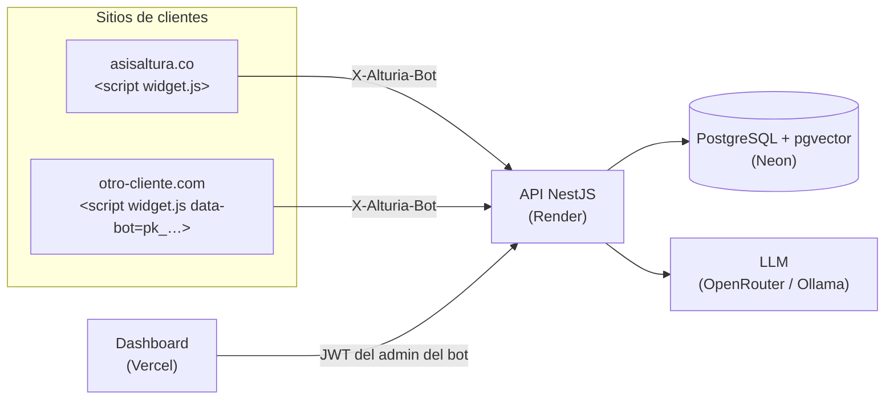

<p align="center"></p>

<p align="center">


</p>

# AlturiaBot

Chatbot embebible para sitios web: una sola plataforma sirve a muchos clientes, cada uno con
su marca, su asistente y su panel. El primer cliente es **Asis Altura** (certificación en
trabajo en alturas), que además usa funcionalidades propias: consulta de certificados por
cédula o QR y agendamiento de cursos.



## Cómo funciona por cliente

Cada cliente es un **bot** con nombre, saludo, color, logo, persona del asistente, palabras
de escalamiento, preguntas rápidas, base de conocimiento y funcionalidades activas. Sus
conversaciones, escalamientos y administradores están aislados de los demás bots.

```html
<script src="https://alturia-widget.vercel.app/widget.js" data-bot="pk_demo" defer></script>
```

- Sin `data-bot`, el widget usa el bot por defecto (Asis Altura), así los embeds anteriores
  siguen funcionando.
- Cada cliente edita su marca en el dashboard. El logo se guarda en Postgres porque el disco de
  Render free es efímero.
- Las funcionalidades de dominio (`CERTIFICATES`, `QR`, `APPOINTMENTS`) leen datos de Asis
  Altura, por eso solo se activan desde la base de datos. Las genéricas (`FAQ`, `HUMAN_HANDOFF`)
  las activa cada cliente.

## Desarrollo local

Requisitos: Node 22 (`.nvmrc`), pnpm 10, Docker y, opcionalmente, Ollama.

```bash
pnpm install
cp .env.example .env    # un solo .env para todo el monorepo
ollama pull qwen2.5:7b  # solo si LLM_CHAT_PROVIDER=ollama
pnpm dev                # Postgres + migraciones + seed, y luego todo en paralelo
```

`pnpm dev` deja corriendo el API (http://localhost:3000), el dashboard (http://localhost:5173),
el widget (http://localhost:5174) y `shared` en modo watch, con los logs de cada uno etiquetados.
Para levantar una sola parte: `pnpm dev:api`, `pnpm dev:dashboard` o `pnpm dev:widget`.

El API valida todas las variables al arrancar (`apps/api/src/config/env.schema.ts`) y avisa
cuál falta. Para probar el embed real: `pnpm --filter widget build`, `npx serve apps/widget/dist`
y abrir `/test.html`. Ahí aparecen los dos bots del seed.

### Datos demo

| Qué | Valor |
| --- | --- |
| Bots | `pk_asisaltura` (Asis Altura, por defecto) · `pk_demo` (Café Ladera) |
| Admins | `admin@asisaltura.co` · `admin@cafeladera.co` (contraseña `SEED_ADMIN_PASSWORD`) |
| Cédulas | `1036482117` (todo vigente) · `1234567890` (curso vencido) |
| Contenido de QR | `demo-worker1-course` · `demo-worker1-medical` · `demo-worker2-course` · `demo-worker2-medical` |

El QR solo lleva un token opaco. El API también acepta `alturia://certificate/<token>`,
`…/certificates/<token>` y `?token=<token>`.

## Despliegue (todo en planes gratuitos)

| Servicio | Qué corre | Notas |
| --- | --- | --- |
| Render | API (`render.yaml`) | El build aplica `prisma migrate deploy` y el seed en cada deploy. El seed nunca pisa bots ni admins existentes. Se duerme tras 15 min (arranque de ~1 min). |
| Neon | PostgreSQL + pgvector | `DATABASE_URL` con `?sslmode=require`. No borra datos por inactividad. |
| Vercel | Widget y dashboard | Dos proyectos: raíz `apps/widget` y `apps/dashboard`, con "Include files outside the Root Directory" activado. Variables: `VITE_WIDGET_API_BASE_URL` y `VITE_API_BASE_URL`. |
| OpenRouter | LLM de producción | Modelo gratuito en `OPENROUTER_CHAT_MODEL`. Los modelos `:free` se retiran con el tiempo. |

En Render hay que definir `DATABASE_URL`, `OPENROUTER_API_KEY` y `SEED_ADMIN_PASSWORD`;
`JWT_SECRET` se genera solo.

## Scripts

| Comando | Qué hace |
| --- | --- |
| `pnpm lint` · `pnpm typecheck` · `pnpm format:check` | Calidad en todo el monorepo (lo mismo que corre CI) |
| `pnpm test` | Pruebas unitarias del API y Vitest del widget y el dashboard |
| `pnpm --filter api run test:e2e` | E2E del API contra un Postgres desechable (Testcontainers; solo requiere Docker) |
| `pnpm db:migrate:new --name x` | Crea una migración sin aplicarla, para revisarla (ver `apps/api/prisma/README.md`) |

## Estructura

```
apps/api        API NestJS: bots, chat, escalamientos, conocimiento y dominio de Asis Altura
apps/widget     widget.js embebible (React en Shadow DOM), un build para todos los bots
apps/dashboard  Panel de cada cliente: escalamientos, conocimiento y apariencia
packages/shared Esquemas Zod compartidos entre API, widget y dashboard
mockups/        Diseños del Sprint 0
designs/        Diagramas de arquitectura
```
